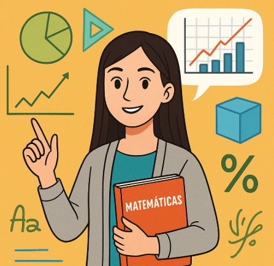

# PAU Mates CV

**Practica Matemáticas de 1º y 2º de Bachillerato orientadas a la PAU de la Comunitat Valenciana.** Ejercicios interactivos, pistas, trucos, soluciones paso a paso y simulacros cronometrados. Sin backend, sin cuentas y con funcionamiento sin conexión.

**App:** https://sergarb1.github.io/PracticaMatesPAU/

## El Círculo de las Mates



PAU Mates CV es un proyecto de [El Círculo de las Mates](https://sergarb1.github.io/elcirculodelasmates). Aquí tienes el banco de ejercicios, las explicaciones y la guía didáctica.

## Qué incluye

- **4 materias seleccionables:** Matemáticas II y Matemáticas Aplicadas a las CCSS II (2º Bachillerato, lo que se examina en la PAU), y Matemáticas I y CCSS I (1º Bachillerato, la base).
- **262 ejercicios** repartidos en 21 bloques temáticos y tres niveles (básico, medio y nivel PAU), todos de opción múltiple y pensados para responder tocando en el móvil, con:
  - corrección automática de opción múltiple, sin escribir resultados,
  - **pista** antes de la solución,
  - **solución paso a paso**,
  - **truco** de examen y **error típico**,
  - fuente del ejercicio.
- **Modo Pasos:** reordena las fases de una solución. Entrena el razonamiento y la presentación, no solo el resultado.
- **Simulacro:** 90 minutos, una pregunta por sección y corrección al entregar, con la estructura de Matemáticas II (4 × 2,5) y CCSS II (3 + 3,5 + 3,5).
- **Formulario** por materia y bloque, listo para imprimir.
- **Guía PAU** con estructura, criterios y novedades de 2026/27.
- **Progreso local:** ejercicios dominados, precisión, racha, marcados para repaso e historial de simulacros.
- **PWA instalable** y offline. KaTeX va incluido en el repositorio, así que las fórmulas también se renderizan sin conexión.

## Modos de práctica

| Modo | Qué hace |
|---|---|
| **Entrenar** | Filtra por materia, bloque y nivel o salta directamente al ejercicio que quieras; responde, comprueba, pide pista o abre la solución. |
| **Pasos** | Coloca los pasos de una solución en el orden correcto. |
| **Simulacro** | Examen de 90 minutos con corrección automática y revisión razonada. |
| **Formulario** | Consulta rápida de fórmulas esenciales. |
| **Guía** | Estructura de la PAU, criterios, calculadora, tablas e instalación. |
| **Progreso** | Estadísticas, repaso marcado e historial. |

## Contenido

| Materia | Ejercicios | Bloques |
|---|---:|---|
| Matemáticas II | 64 | Probabilidad, Matrices, Sistemas, Complejos, Límites, Derivadas, Integrales, Optimización, Vectores, Rectas y planos, Geometría |
| CCSS II | 78 | Probabilidad, Estadística, Inferencia, Matrices, Sistemas, Sucesiones, Programación lineal, Funciones, Límites, Derivadas, Integrales |
| Matemáticas I | 64 | Álgebra, Números reales, Sucesiones, Trigonometría, Cónicas, Vectores, Funciones, Límites, Derivadas |
| CCSS I | 56 | Números, Álgebra, Sucesiones, Estadística, Funciones, Probabilidad |

CCSS II está separado **por bloque** en `js/data/ccss-ii/`; el resto de materias, por nivel. Es fácil revisarlo o ampliarlo, también con ayuda de una IA. El esquema completo está en [`js/data/README.md`](js/data/README.md) y la guía para agentes en [`AGENTS.md`](AGENTS.md).

## Estructura

```
index.html                  Shell y orden de carga
css/styles.css              Sistema visual responsive, tema claro/oscuro
js/app.js                   Estado, vistas, corrección, simulacro y PWA
js/formulas.js              Formularios por materia
js/data/ccss-ii/<bloque>.js  Banco de CCSS II por bloque
js/data/<materia>/nivel-N.js  Banco del resto por materia y nivel
img/                        Foto de la autora y recursos gráficos
tools/audit.html            Auditoría interactiva del banco
vendor/                     KaTeX local (CSS, JS, auto-render y fuentes)
icons/                      Iconos de la PWA
sw.js                       Service Worker (offline)
manifest.webmanifest        Manifest de instalación
scripts/validar-banco.mjs   Validación del contenido
scripts/                    Herramientas de contenido y prueba de humo
handsoff.md                 Traspaso técnico y estado del proyecto
```

## Uso local

No hay instalación ni build. Solo necesitas un servidor estático para probar la PWA:

```bash
npm run serve
# http://localhost:8080
```

También puedes abrir `index.html` con doble clic: la práctica funciona, pero el Service Worker y la instalación requieren `http(s)`.

### Validar el banco

```bash
npm run validate
```

Comprueba ids, campos, niveles, coherencia carpeta/materia/bloque, respuestas, opciones, pasos y que todos los recursos precacheados existan.

### Auditoría interactiva

La página [`tools/audit.html`](tools/audit.html) valida el banco en el navegador: estructura, respuestas, opciones, coherencia de archivos, LaTeX y recuentos. También está publicada en https://sergarb1.github.io/PracticaMatesPAU/tools/audit.html. Expone el resultado en `window.__audit` y permite descargar un informe JSON.

## Añadir ejercicios

1. En CCSS II elige `js/data/ccss-ii/<bloque>.js`; en el resto, `js/data/<materia>/nivel-N.js`.
2. Copia la estructura de un ejercicio existente (ver esquema en `js/data/README.md`).
3. Incluye siempre `pista`, `solucion`, `truco` y `errorTipico`.
4. Ejecuta `npm run validate` y prueba en el navegador.

## PWA y funcionamiento sin conexión

- El manifest usa rutas relativas, así que funciona en un subdirectorio de GitHub Pages.
- El Service Worker precachea el shell, los datos, KaTeX y los iconos; las fuentes de KaTeX se cachean al usarse.
- El progreso se guarda en `localStorage` del dispositivo. No se envía nada a ningún servidor.
- Instalación: botón **Instalar app** en la cabecera (Chrome/Edge) o **Compartir → Añadir a pantalla de inicio** en Safari/iOS.

## Publicación

El sitio se sirve desde la rama `main`, carpeta raíz, en GitHub Pages. Para actualizarlo:

```bash
git add -A
git commit -m "Actualiza el banco o la app"
git push origin main
```

## Fuentes y criterios

- Estructura y criterios oficiales: [Universitats · Generalitat Valenciana](https://universitats.gva.es/).
- Exámenes de CCSS II 2017–2026: [EBAU Valencia · EbauMatemáticas](https://www.ebaumatematicas.com/wp-content/uploads/2026/08/Mates-CCSS-II_EBAU_Valencia_2017-2026.pdf).
- Exámenes resueltos y enfoque didáctico: [SelectivoMates · sergarb1/MatematicasPAU](https://sergarb1.github.io/MatematicasPAU/).
- Seguimiento de convocatorias: [Academia La Llibreta](https://academialallibreta.es/).

Los ejercicios son **material propio adaptado** al estilo de la PAU, no enunciados oficiales. La convocatoria y los criterios publicados por la Comisión de Materia prevalecen sobre esta app.

## Licencia

MIT © 2026 El Círculo de las Mates. KaTeX se distribuye con licencia MIT; consulta `vendor/README.txt`.
